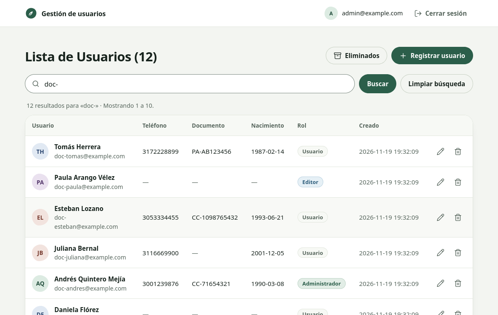
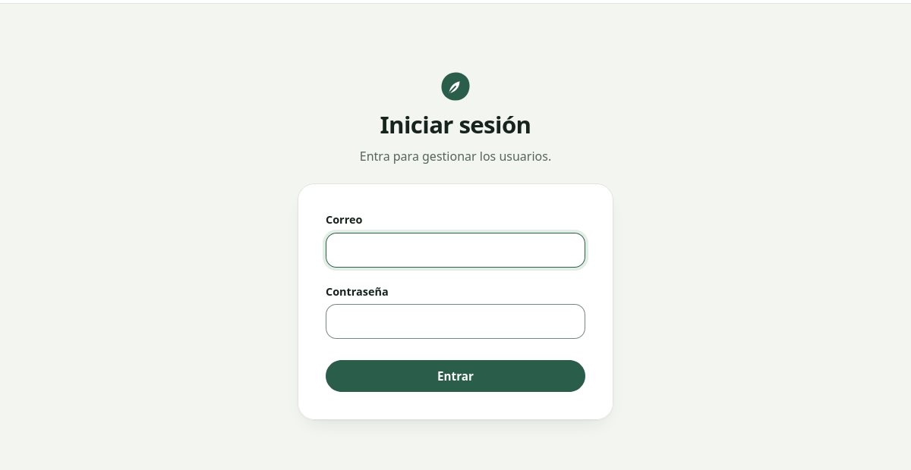
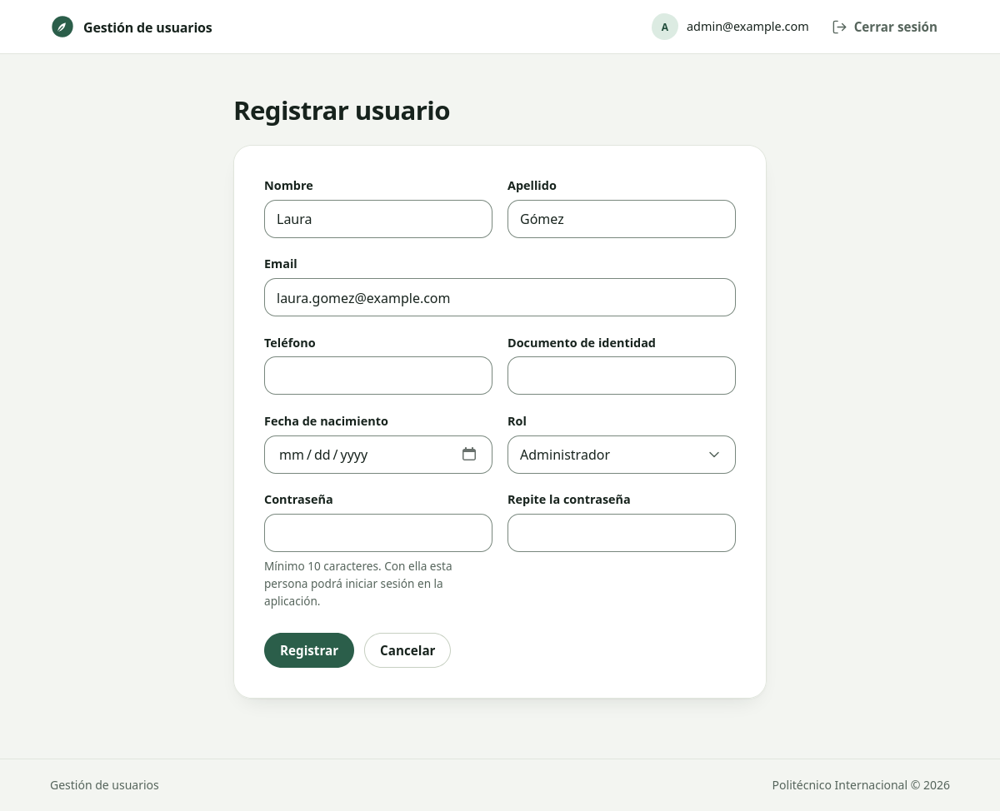
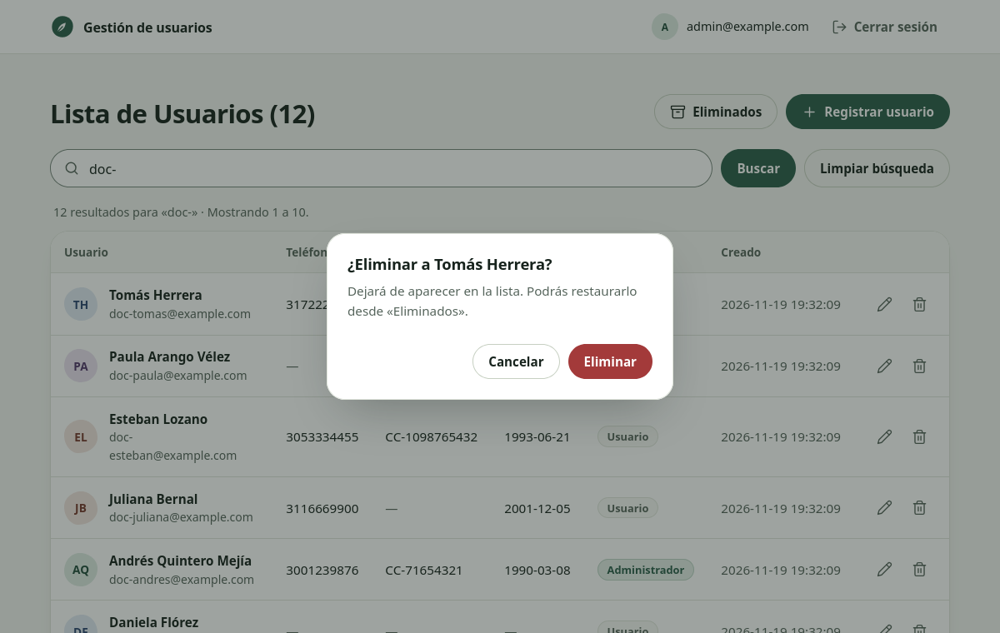
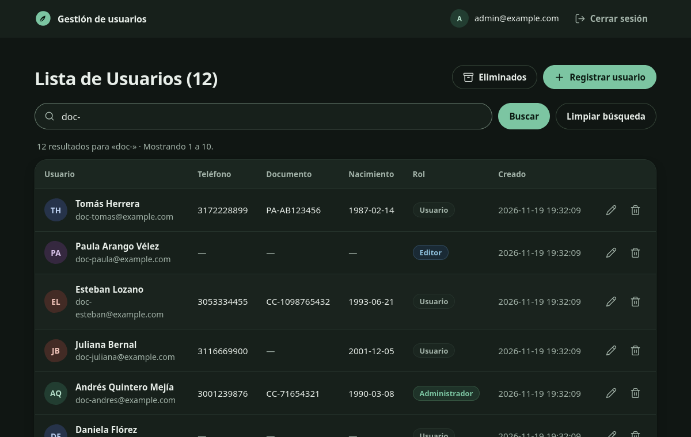
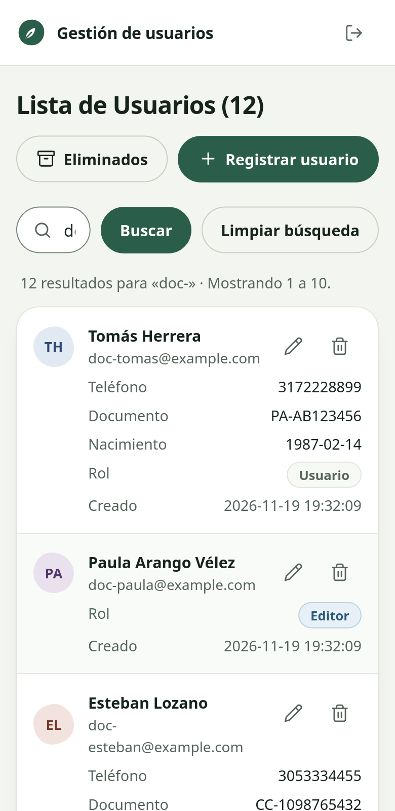

# Gestión de usuarios

Aplicación web para administrar un directorio de personas: alta, búsqueda, edición, eliminación reversible y acceso protegido para quienes la administran. Está hecha en **PHP 8.4 puro** (sin frameworks) sobre **MySQL 8.4**, se ejecuta completa con **Docker Compose** y no depende de ningún servicio externo: ni CDN, ni fuentes, ni scripts de terceros.



- [Características](#características)
- [Capturas](#capturas)
- [Inicio rápido](#inicio-rápido)
- [Configuración](#configuración)
- [Uso](#uso)
- [Arquitectura](#arquitectura)
- [Base de datos](#base-de-datos)
- [Seguridad](#seguridad)
- [Interfaz y accesibilidad](#interfaz-y-accesibilidad)
- [Pruebas](#pruebas)
- [Operación](#operación)
- [Puesta en producción](#puesta-en-producción)
- [Solución de problemas](#solución-de-problemas)
- [Desarrollo](#desarrollo)
- [Limitaciones conocidas y hoja de ruta](#limitaciones-conocidas-y-hoja-de-ruta)
- [Documentación adicional](#documentación-adicional)

## Características

**Gestión de usuarios**
- Alta y edición con validación en servidor: nombre, apellido, correo (único), teléfono, documento de identidad (único, opcional), fecha de nacimiento y rol.
- **Búsqueda** por nombre, apellido, nombre completo, correo, teléfono o documento; ignora mayúsculas y tildes y trata `%`, `_` y `\` como texto.
- **Paginación** de 10 en 10 que conserva la búsqueda y la vista al editar, cancelar, eliminar o restaurar.
- **Borrado lógico**: eliminar no destruye el dato; hay una vista de eliminados con **Restaurar**.
- **Control de ediciones simultáneas**: si otra persona modificó al usuario mientras lo editabas, se avisa (409) en lugar de pisar sus cambios.

**Acceso**
- Inicio de sesión para administradores. Un usuario con rol *Administrador* y una contraseña puede entrar; se registra desde la propia pantalla de usuarios.
- Sesión con cookie `HttpOnly` y `SameSite=Lax`, que caduca a los 30 minutos de inactividad.
- Protección CSRF en todos los formularios, comprobación del origen de cada petición y contraseñas guardadas con bcrypt.

**Interfaz**
- Diseño propio, sin librerías de CSS: modo claro y oscuro automáticos, adaptable a móvil y accesible con teclado.
- Confirmaciones con un diálogo propio, avisos que se cierran y protección contra el doble envío.

**Ingeniería**
- Código en capas (controladores, validador, repositorios, entidad, vistas) con autoload de Composer y una sola clase con acceso al SQL.
- Dos usuarios de base de datos con **mínimo privilegio**: uno para la aplicación y otro, solo manual, para las migraciones.
- Más de 1.500 comprobaciones automáticas: unitarias, de integración, de arquitectura, de permisos, de migraciones y de punta a punta.

## Capturas

| Inicio de sesión | Registrar un administrador |
|:---:|:---:|
|  |  |

| Confirmación al eliminar | Modo oscuro | Móvil |
|:---:|:---:|:---:|
|  |  |  |

## Inicio rápido

**Requisitos:** Docker y Docker Compose v2. (Para ejecutar las pruebas de punta a punta también hacen falta `bash` y `curl`.)

```bash
git clone <url-del-repositorio> gestion-usuarios
cd gestion-usuarios
cp .env.example .env          # trae claves de DESARROLLO que ya funcionan
docker compose up -d --build
```

La primera vez, MySQL crea la base, las tablas, los datos de ejemplo y los dos usuarios de base de datos; el contenedor de PHP genera `vendor/` (el autoload de Composer). Cuando `docker compose ps` muestre los cuatro servicios en marcha y `db` en `healthy`:

| Servicio | Dirección | Notas |
|----------|-----------|-------|
| Aplicación | http://localhost:8080 | Solo escucha en `127.0.0.1` |
| Adminer (cliente de BD) | http://localhost:8081 | Sistema MySQL, servidor `db`; solo en `127.0.0.1` |
| Diagnóstico del stack | http://localhost:8080/status.php | Solo con `APP_ENV=local` |

### Cuentas de desarrollo

Son **claves conocidas, solo para tu máquina**. Cámbialas o bórralas antes de exponer la aplicación (ver [Puesta en producción](#puesta-en-producción)).

| Cuenta | Para qué | Usuario | Clave |
|--------|----------|---------|-------|
| Administrador de la aplicación | Entrar en `/login.php` | `admin@example.com` | `Admin-Demo-2026` |
| Base de datos: aplicación | La usa PHP en cada petición (solo lee y escribe filas) | `crud_app` | `crud_app_dev_2026` |
| Base de datos: migraciones | Cambiar el esquema y tareas manuales | `crud_migrator` | `crud_migrator_dev_2026` |
| `root` de MySQL | Administrar el servidor | `root` | `cambia-esta-clave-root` |

> El administrador de desarrollo es un usuario más del listado. En una BD creada antes, el seed no se vuelve a ejecutar: crea el tuyo con `bin/as-migrator php scripts/create-admin.php correo@ejemplo.com`.

## Configuración

Toda la configuración llega por **variables de entorno** definidas en `.env` (que no se sube a git). `.env.example` es la plantilla.

| Variable | Por defecto | Descripción |
|----------|-------------|-------------|
| `APP_ENV` | `local` | `local`: errores en pantalla y `status.php`. Cualquier otro valor (p. ej. `production`): modo seguro, errores solo al log y `status.php` responde 404. |
| `APP_PORT` | `8080` | Puerto en el que se publica la aplicación (en `127.0.0.1`). |
| `APP_ORIGIN` | `http://localhost:${APP_PORT}` | Origen público (esquema + host + puerto, sin ruta). Los POST solo se aceptan si vienen de este origen. Con `https://` la cookie de sesión pasa a `Secure`. `localhost` y `127.0.0.1` son orígenes distintos. |
| `DB_HOST`, `DB_PORT` | `db`, `3306` | Dónde está MySQL (el servicio `db` de Compose). |
| `DB_DATABASE` | `crud_usuarios` | Nombre de la base. |
| `DB_USERNAME`, `DB_PASSWORD` | `crud_app` y su clave | Usuario de **la aplicación**. Solo `SELECT`, `INSERT` y `UPDATE` sobre `users`. |
| `DB_MIGRATION_USERNAME`, `DB_MIGRATION_PASSWORD` | `crud_migrator` y su clave | Usuario de **migraciones**: todos los permisos sobre la base. El contenedor `php` no lo conoce (ver `bin/as-migrator`). Obligatoria: sin ella `docker compose` falla con un aviso. |
| `DB_ROOT_PASSWORD` | `cambia-esta-clave-root` | Clave de `root` de MySQL. Solo se usa dentro del contenedor `db`. |
| `ADMINER_PORT` | `8081` | Puerto de Adminer (en `127.0.0.1`). |
| `HOST_UID`, `HOST_GID` | `1000` | UID y GID de tu usuario (`id -u`, `id -g`), para que los archivos creados desde el contenedor sean tuyos. |
| `XDEBUG_MODE` | `off` | `debug` para depurar con VS Code (puerto 9003). |

Tras cambiar una variable, recrea los contenedores: `docker compose up -d`. MySQL conserva los usuarios ya creados: si cambias `DB_PASSWORD` o `DB_MIGRATION_PASSWORD` en una instalación existente, ejecuta `docker compose exec db bash /docker-entrypoint-initdb.d/03-users.sh`, que actualiza las claves (la de `root` solo se cambia con `docker compose down -v`, que borra los datos).

## Uso

### Roles y acceso

| Rol | Puede iniciar sesión | Significado |
|-----|:---:|-------------|
| Administrador (`admin`) | Sí, si tiene contraseña | Gestiona todos los usuarios. |
| Editor (`editor`) | No | Etiqueta del directorio. |
| Usuario (`user`) | No | Etiqueta del directorio. |

Para dar acceso a alguien: **Registrar usuario** (o **Editar**), rol *Administrador* y una contraseña de 10 a 72 bytes. Cambiar el correo cambia con qué correo entra; quitarle el rol **borra su contraseña**; eliminarlo le quita el acceso y restaurarlo se lo devuelve. Dejar la contraseña vacía al editar conserva la actual. **Nadie puede eliminarse ni quitarse el rol a sí mismo.**

### Rutas

Todas exigen sesión salvo `login.php`. Los métodos que cambian datos son siempre `POST`.

| Método | Ruta | Descripción |
|--------|------|-------------|
| GET | `/` | Listado. Parámetros: `q` (búsqueda), `page`, `view=inactive` (eliminados). |
| GET, POST | `/create.php` | Formulario de alta y su proceso. |
| GET, POST | `/edit.php?id=N` | Formulario de edición y su proceso. |
| POST | `/delete.php` | Elimina (borrado lógico). |
| POST | `/restore.php` | Restaura a un eliminado. |
| GET, POST | `/login.php` | Formulario y proceso de inicio de sesión. |
| POST | `/logout.php` | Cierra la sesión. |
| GET | `/status.php` | Diagnóstico del stack (solo `APP_ENV=local`). |

### Códigos de respuesta

Si una operación no se completó, nunca responde 200.

| Código | Cuándo |
|--------|--------|
| 302 | Tras una acción correcta; sin sesión, hacia `login.php`. |
| 400 | `delete.php` o `restore.php` con un id mal formado. |
| 401 | Credenciales incorrectas (siempre el mismo mensaje). |
| 403 | Origen no permitido o token CSRF inválido. |
| 404 | Usuario inexistente, eliminado o id inválido en `edit.php`. |
| 405 | Método incorrecto (`delete.php`, `restore.php` y `logout.php` solo admiten POST). |
| 409 | Correo o documento duplicado, o edición simultánea. |
| 422 | Datos del formulario inválidos. |
| 500 / 503 | Fallo de consulta o configuración / base de datos no disponible. Sin detalles técnicos en pantalla; el detalle va al log. |

## Arquitectura

```
Petición ─► nginx ─► PHP-FPM ─► public/*.php ─► Controlador ─► Validador ─┐
                                                    │                      ▼
                                                    ├──────────────► Repositorio ─► MySQL
                                                    ▼
                                                  Vista (views/) ─► HTML
```

| Capa | Dónde | Responsabilidad | No hace |
|------|-------|-----------------|---------|
| Página | `src/public/*.php` | Arranca y llama a un método de un controlador (7 líneas). | Nada más. |
| Controlador | `src/app/Controller/` | Comprueba quién pide (origen, sesión, CSRF), lee la petición, usa el validador y el repositorio, elige vista o redirección. | No tiene SQL ni HTML. |
| Validación | `src/app/Validation/` | Campos y reglas de un usuario, las mismas al crear y al editar. | No toca la BD ni la petición. |
| Repositorio | `src/app/Repository/` | **El único lugar con SQL**: buscar, contar, crear, actualizar, eliminar, restaurar. | No sabe de HTTP ni de HTML. |
| Entidad | `src/app/Domain/User.php` | Los datos de un usuario, tipados e inmutables. | No sabe de SQL. |
| Vista | `src/views/` | HTML con la mínima lógica; toda salida escapada. | No consulta la BD ni lee la petición. |

Decisiones relevantes:
- **Autoload PSR-4** (`App\` → `src/app/`) con Composer. No hay dependencias de terceros: Composer solo aporta el autoload. `vendor/` no se versiona; el contenedor lo genera al arrancar si falta.
- **Inyección de dependencias**: `UserRepository` recibe el `PDO` en el constructor. `Container` arma las piezas y abre la conexión **solo cuando hace falta**, de modo que una petición inválida (un id mal formado, un token incorrecto) se rechaza sin tocar la BD.
- **Orden de comprobaciones** en cada POST: método (405) → origen (403) → sesión (302) → token CSRF (403) → datos (400/404/422) → BD.
- **Errores**: `Failure::describe()` traduce una excepción (`DatabaseConnectionException` → 503, `PDOException` → 500, valor repetido → 409) en un código y un aviso genérico, y registra el detalle.
- `src/tests/architecture.php` vigila estas reglas: solo los repositorios ejecutan SQL, las vistas no tocan la BD y toda salida lleva `escape()`.

### Estructura del proyecto

```
.
├── docker-compose.yml        # nginx, php-fpm, mysql y adminer
├── .env.example              # plantilla de configuración
├── docker/                   # Dockerfile de PHP, php.ini, nginx (cabeceras y CSP), entrypoint
├── database/
│   ├── 01-schema.sql         # esquema de una instalación nueva
│   ├── 02-seed.sql           # datos de ejemplo y administrador de desarrollo
│   ├── 03-users.sh           # crea los usuarios de BD con mínimo privilegio
│   └── migrations/           # cambios de esquema para una BD existente (001 a 004)
├── bin/as-migrator           # ejecuta un comando de PHP como usuario de migraciones
├── tests/                    # pruebas de punta a punta, permisos y migraciones
└── src/                      # montado en /var/www/html
    ├── public/               # raíz web: páginas, css/, js/, img/
    ├── app/                  # Controller, Repository, Domain, Validation, Search, Http, Auth, Database, View, Security…
    ├── views/                # plantillas HTML
    ├── scripts/              # solo consola: create-admin.php, seed-demo.php, db-check.php
    ├── tests/                # unit.php, integration.php, architecture.php
    ├── bootstrap.php         # carga el autoload
    └── composer.json
```

## Base de datos

**`users`**

| Columna | Tipo | Notas |
|---------|------|-------|
| `id` | `INT UNSIGNED` | PK, autoincremental. |
| `name`, `last_name` | `VARCHAR(100)` | Obligatorios. |
| `email` | `VARCHAR(254)` | Obligatorio, **único**; se guarda en minúsculas. |
| `phone` | `VARCHAR(20)` | Opcional. |
| `document` | `VARCHAR(20)` | Opcional, **único** (varios `NULL` conviven); se guarda en mayúsculas. |
| `birth_date` | `DATE` | Opcional; no futura ni anterior a 1900. |
| `role` | `ENUM('user','editor','admin')` | Por defecto `user`. |
| `password_hash` | `VARCHAR(255)` | Hash bcrypt; `NULL` = no puede iniciar sesión. |
| `active` | `TINYINT(1)` | 1 visible, 0 eliminado. Índice `(active, id)`. |
| `created_at` | `DATETIME` | En UTC. |

Quien puede iniciar sesión es un usuario con `role = 'admin'`, `active = 1` y `password_hash` no nulo.

**Fechas.** Se guardan en UTC (MySQL arranca con `--default-time-zone=+00:00` y cada conexión ejecuta `SET time_zone`) y se muestran en la zona `date.timezone` de `docker/php/php.ini` (hoy `America/Bogota`). Adminer y el cliente `mysql` muestran la hora en UTC.

### Usuarios de la base de datos

| Usuario | Permisos | Se usa para |
|---------|----------|-------------|
| `crud_app` | `SELECT`, `INSERT`, `UPDATE` sobre `users` | La aplicación web. No puede `DELETE`, `DROP`, `ALTER`, `CREATE`, ni leer otras bases. |
| `crud_migrator` | Todos sobre `crud_usuarios`, sin `GRANT OPTION` | Migraciones y tareas manuales, vía `bin/as-migrator`. |

`database/03-users.sh` los crea con las claves de `.env` (un `.sql` no puede leer variables de entorno) y es repetible. Como la aplicación registra administradores, `crud_app` puede escribir `role` y `password_hash`.

### Migraciones

Una instalación nueva usa `01-schema.sql`; una BD existente se actualiza con los archivos de `database/migrations/`, **en orden y una sola vez** (una segunda ejecución falla sin cambiar nada). `01-schema.sql` debe llevar siempre lo mismo que las migraciones; los scripts `tests/migration-00N.sh` lo verifican.

```bash
# Haz una copia antes (ver «Copias de seguridad»)
docker compose exec -T db sh -c 'mysql -uroot -p"$MYSQL_ROOT_PASSWORD" crud_usuarios' < database/migrations/004-user-passwords.sql
```

| Migración | Cambio |
|-----------|--------|
| `001-more-fields.sql` | Documento, fecha de nacimiento y rol. |
| `002-active.sql` | Borrado lógico (`active`) e índice `(active, id)`. |
| `003-admins.sql` | Tabla `admins` (sustituida por la 004). |
| `004-user-passwords.sql` | `users.password_hash`; los administradores pasan a `users` y se borra `admins`. **Sin vuelta atrás automática.** |

## Seguridad

| Control | Implementación |
|---------|----------------|
| Inyección SQL | Consultas preparadas nativas (`EMULATE_PREPARES=false`); lo que escribe la persona nunca se concatena en el SQL. |
| XSS | Toda salida HTML pasa por `escape()` (comprobado por `architecture.php`); CSP sin scripts ni estilos en línea. |
| CSRF | Token por sesión (`hash_equals`) en los seis formularios POST, renovado al iniciar sesión; más comprobación de `Origin`/`Referer` y cookie `SameSite=Lax`. |
| Autenticación | bcrypt; mensaje, código y **tiempo** idénticos para correo inexistente, clave mala, rol sin acceso o usuario eliminado (se verifica contra un hash ficticio). Contraseñas de 10 a 72 bytes y sin NUL (bcrypt truncaba). |
| Sesión | Cookie `crud_session` (`HttpOnly`, `SameSite=Lax`, `Secure` con HTTPS), `session.use_strict_mode`, id nuevo al entrar (fijación de sesión), caducidad a los 30 min de inactividad, `Cache-Control: no-store` en páginas protegidas. |
| Cabeceras | `Content-Security-Policy` (`default-src 'self'`), `X-Frame-Options: DENY`, `X-Content-Type-Options`, `Referrer-Policy`, `Permissions-Policy`; nginx oculta su versión. |
| Mínimo privilegio | Usuario de BD de la aplicación sin `DELETE` ni DDL; el de migraciones no se entrega a la aplicación. |
| Errores | Mensajes genéricos al visitante; el detalle solo en el log. Con `APP_ENV` distinto de `local`, PHP no muestra errores. |
| Red | nginx y Adminer solo escuchan en `127.0.0.1`; MySQL no se publica. |

Más detalle sobre el diseño de cada control (y lo que se midió) en [`plan.md`](plan.md). Para **reportar una vulnerabilidad**, avisa en privado a quien mantenga el repositorio antes de abrir una incidencia pública.

## Interfaz y accesibilidad

- Hoja de estilos propia (`src/public/css/app.css`) con variables para colores, radios y tiempos; cambiar el acento es cambiar `--primary`.
- Tipografía del sistema, iconos propios en un SVG (`img/icons.svg`) y JavaScript sin dependencias (`js/app.js`).
- Modo claro y oscuro según el sistema, `prefers-reduced-motion` respetado, contraste de texto de 4,5:1 o más y de 3:1 o más en los bordes de los campos.
- Navegable con teclado: foco visible, enlace «Saltar al contenido», etiquetas y errores asociados a cada campo.
- En móvil, el listado pasa de tabla a tarjetas.
- Verificado con Playwright en Firefox (escritorio, tableta y móvil, claro y oscuro). **No se ha probado en Chrome ni en Safari.**

## Pruebas

No necesitan instalar nada más. Con la aplicación levantada:

```bash
tests/run-all.sh                  # todas, con un resumen
tests/run-all.sh --with-db-stop   # además comprueba los 503 parando y levantando la BD
```

| Nivel | Comando | Qué comprueba |
|-------|---------|---------------|
| Unitarias | `docker compose exec php php tests/unit.php` | Validador, entidad, búsqueda, paginación, contraseñas, sesión, origen. Sin BD. |
| Arquitectura | `docker compose exec php php tests/architecture.php` | Solo los repositorios ejecutan SQL; las vistas no tocan la BD y escapan; el autoload carga cada clase. |
| Integración | `bin/as-migrator php tests/integration.php` | Los repositorios contra MySQL, con tablas temporales que no tocan tus datos. |
| Migraciones | `tests/migration-001.sh` … `-004.sh` | Aplicar cada migración deja el mismo esquema que una instalación nueva y conserva los datos. |
| Permisos | `tests/privileges.sh` | Qué puede y qué **no** puede hacer cada usuario de BD (`DROP`, `ALTER`, `DELETE`, `GRANT`…). |
| De punta a punta | `tests/smoke.sh [--with-db-stop]` | La aplicación real con `curl`: códigos, redirecciones, cabeceras, sesión, CSRF, búsqueda, paginación, borrado lógico y acceso. |

Todas terminan con código 0 si pasan y 1 si fallan, así que sirven para integración continua. `smoke.sh` solo crea y borra datos `smoke-*@example.com`; si cambias el puerto o el origen, usa `BASE_URL` y `ORIGIN`.

## Operación

### Comandos habituales

| Acción | Comando |
|--------|---------|
| Levantar / apagar (conserva los datos) | `docker compose up -d` / `docker compose down` |
| Apagar y **borrar la BD** | `docker compose down -v` |
| Logs (todos / PHP) | `docker compose logs -f` / `docker compose logs -f php` |
| Shell en PHP | `docker compose exec php sh` |
| Comando de PHP como usuario de migraciones | `bin/as-migrator php scripts/create-admin.php correo@ejemplo.com` |
| Datos de demostración (crear / borrar) | `bin/as-migrator php scripts/seed-demo.php 35` / `… --clean` |
| Comprobar la conexión a MySQL | `docker compose exec php php scripts/db-check.php` |
| Ejecutar un `.sql` como root | `docker compose exec -T db sh -c 'mysql -uroot -p"$MYSQL_ROOT_PASSWORD" crud_usuarios' < archivo.sql` |
| Reiniciar nginx tras cambiar `docker/nginx/default.conf` | `docker compose restart nginx` |

### Copias de seguridad

```bash
# Copia
docker compose exec -T db sh -c 'mysqldump -uroot -p"$MYSQL_ROOT_PASSWORD" --single-transaction --default-character-set=utf8mb4 crud_usuarios' > copia-$(date +%F).sql

# Restauración (sobre una base vacía o la misma)
docker compose exec -T db sh -c 'mysql -uroot -p"$MYSQL_ROOT_PASSWORD" --default-character-set=utf8mb4 crud_usuarios' < copia-2026-01-31.sql
```

Haz una copia **antes de cada migración**. La copia contiene los hashes de las contraseñas: trátala como un dato sensible.

### Actualizar a una versión nueva

```bash
git pull
docker compose up -d --build                    # reconstruye PHP si cambió el Dockerfile
# aplica en orden las migraciones nuevas de database/migrations/ (ver «Migraciones»)
tests/run-all.sh                                # comprueba que todo sigue bien
```

### Registros y diagnóstico

Los errores van al log del contenedor (`docker compose logs php`) con una etiqueta: `[connection]` (sin conexión a la BD), `[query]` (una consulta falló, p. ej. por un permiso que falta) o `[config]` (falta una variable). Con `APP_ENV=local`, `/status.php` enseña las versiones y si la BD responde.

## Puesta en producción

Esta configuración está pensada para **desarrollo y pruebas**. Antes de exponerla a usuarios reales:

- [ ] `APP_ENV=production` (PHP deja de mostrar errores y `status.php` responde 404).
- [ ] **HTTPS delante**: termina TLS en un proxy inverso o balanceador y fija `APP_ORIGIN=https://tu-dominio` (activa la cookie `Secure`). Sin HTTPS la contraseña viaja en claro.
- [ ] **Cambia todas las claves** de `.env` por valores largos y únicos (idealmente desde un gestor de secretos, no un archivo): `DB_PASSWORD`, `DB_MIGRATION_PASSWORD` y `DB_ROOT_PASSWORD`; ejecuta `03-users.sh` para aplicarlas.
- [ ] **Borra el administrador de desarrollo** (`DELETE FROM users WHERE email = 'admin@example.com'`) y crea el tuyo con `create-admin.php`.
- [ ] **Quita Adminer** del `docker-compose.yml` (o déjalo accesible solo por VPN).
- [ ] No publiques los puertos de nginx directamente: que solo los alcance el proxy.
- [ ] Limita el host de los usuarios de BD (`'crud_app'@'10.0.%'` en lugar de `%`).
- [ ] Programa **copias de seguridad** de la base y prueba que se pueden restaurar.
- [ ] Recoge los logs de los contenedores en un sistema central y vigila los errores 5xx.
- [ ] Añade **límite de intentos** al inicio de sesión (no existe; ver más abajo) en el proxy o en la aplicación.
- [ ] Guarda las sesiones fuera del contenedor si usas más de una instancia (hoy son archivos en `/tmp` de `php`).
- [ ] Sustituye el montaje de `./src` por una imagen que lleve el código (`COPY` en el Dockerfile) y ejecuta `composer install --no-dev`.

## Solución de problemas

| Síntoma | Causa y solución |
|---------|------------------|
| No puedo entrar | Solo entra un usuario con rol *Administrador*, activo y con contraseña. Si nadie puede, crea uno: `bin/as-migrator php scripts/create-admin.php correo@ejemplo.com`. Recrear el contenedor `php` cierra todas las sesiones. |
| «Origen no permitido» (403) | Abres la aplicación con un origen distinto de `APP_ORIGIN` (p. ej. `127.0.0.1` en vez de `localhost`, u otro puerto). |
| «Token de seguridad no válido» (403) | La sesión caducó o el formulario se abrió antes de volver a iniciar sesión: recarga la página. |
| `docker compose` dice «Falta DB_MIGRATION_PASSWORD» | Añade `DB_MIGRATION_USERNAME` y `DB_MIGRATION_PASSWORD` a `.env` (ver `.env.example`), ejecuta `docker compose up -d` y `docker compose exec db bash /docker-entrypoint-initdb.d/03-users.sh`. |
| 500 sin cuerpo y el log dice «Falta vendor/autoload.php» | `docker compose exec php composer install` (o `docker compose up -d --build`, que lo genera al arrancar). |
| `command denied` en el log | El usuario de la aplicación solo tiene `SELECT`, `INSERT` y `UPDATE` sobre `users`. Si añades una consulta nueva, amplía `database/03-users.sh` y ejecútalo. |
| Puerto ocupado | Cambia `APP_PORT` o `ADMINER_PORT` en `.env`. |
| Los archivos creados desde el contenedor son de otro usuario | Ajusta `HOST_UID` y `HOST_GID` (`id -u`, `id -g`) y `docker compose up -d --build`. |
| Tildes rotas (`ó`) al cargar datos | El cliente `mysql` usa `latin1`: añade `--default-character-set=utf8mb4`. Los scripts de `database/` ya llevan `SET NAMES utf8mb4`. |
| Cambié la CSP y no surte efecto | `docker compose restart nginx` (un `reload` puede no releer un archivo montado que se reescribió). |
| Xdebug no conecta | `XDEBUG_MODE=debug` en `.env`, `docker compose up -d`, escucha el puerto 9003 y revisa el firewall. |

## Desarrollo

**Flujo.** Una rama por cambio, pruebas en verde y un commit con un asunto breve en imperativo. Antes de abrir una petición de cambios: `tests/run-all.sh`.

**Convenciones.** Código, tablas y archivos en inglés; textos de la interfaz en español. `declare(strict_types=1);` en todo archivo PHP. Toda salida HTML con `escape()`. Credenciales solo por variables de entorno. Nada que no deba ser accesible por URL va dentro de `src/public/`.

**Añadir un campo a los usuarios** (el recorrido completo):
1. Migración nueva en `database/migrations/` **y** el mismo cambio en `01-schema.sql`; un script `tests/migration-00N.sh` que compruebe que coinciden.
2. `User` (propiedad y `fromRow`), `UserValidator::fields()` y `validate()`, y los parámetros de `UserRepository`.
3. La vista del formulario y la del listado.
4. Si el campo se busca, `UserSearch`.
5. Permisos: si la aplicación necesita algo que no tiene, `database/03-users.sh` y `tests/privileges.sh`.
6. Pruebas unitarias, de integración y de punta a punta; `tests/run-all.sh`.

**Añadir una consulta.** Va en un repositorio, con parámetros enlazados; nunca en un controlador ni en una vista (`architecture.php` falla si ocurre).

## Limitaciones conocidas y hoja de ruta

- **Sin límite de intentos de inicio de sesión.** Diseño propuesto en `plan.md` (retraso progresivo por correo y por IP); hoy conviene aplicarlo en el proxy.
- **Una sesión abierta no se corta al instante** si a esa persona le quitan el acceso: caduca a los 30 minutos de inactividad o al reiniciar el contenedor `php`.
- **Sin recuperación de contraseña**: la cambia otro administrador al editar el usuario. No hay jerarquía entre administradores.
- **Sin borrado definitivo desde la interfaz.** Para suprimir datos personales de verdad (derecho de supresión) usa el usuario de migraciones o `root`; el borrado lógico no destruye el dato.
- **Sin registro de auditoría** (quién cambió qué y cuándo).
- Los roles `editor` y `user` son etiquetas sin permisos propios.
- Probado en Firefox; falta verificación en Chrome y Safari.
- Posibles siguientes pasos: enrutador con un único punto de entrada, PHPUnit, exportación e importación CSV, registro de auditoría, recuperación de contraseña por correo y segundo factor.

## Documentación adicional

- [`plan.md`](plan.md): diario de desarrollo. Cada mejora (búsqueda, paginación, borrado lógico, sesión, CSRF, mínimo privilegio, capas, interfaz y acceso de administradores) con sus decisiones, alternativas descartadas, mediciones y límites.
- [`tests/csrf-demo/`](tests/csrf-demo/README.md): una página «atacante» y una guía para ver en el navegador qué protege cada capa contra CSRF.
